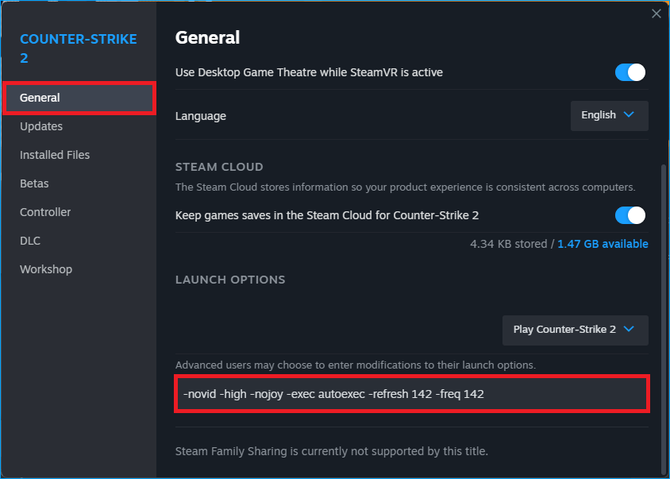

<p align="center">
  
</p>

<p align="center">
  <a href="https://launchoptions.dev"><strong>Visit the Site ↗</strong></a>
</p>

<p align="center">
  <a href="#features">Features</a> •
  <a href="#architecture">Architecture</a> •
  <a href="#local-development">Local Development</a> •
  <a href="#api-documentation">API</a> •
  <a href="#reporting-a-bug">Report a Bug</a>
</p>

---

## Vanilla Slops?

**Vanilla Slops** is a searchable database of launch options for games on [Steam](https://store.steampowered.com/), live at [launchoptions.dev](https://launchoptions.dev). Every option names the source it was documented in. New to launch options? Start with [Steam launch options, explained](https://launchoptions.dev/steam-launch-options).

The name Vanilla Slops is a nod to the use of vanilla JavaScript, with our back-end powered by an Express.js API and Supabase (PostgreSQL).

The core philosophy of this project aims to recreate some of the functionality that modern frameworks abstract away, while remaining lightweight, fast, and secure.

Steam Launch Options (SLOPS) are custom command-line parameters that can improve game performance or unlock features outside of the standard game menus.



---

## Features

#### **Smart Search & Discovery**
- **Real-time search suggestions** across titles, developers, publishers, and launch options
- **Filtering** by developer, engine, option category, risk level, release year, and launch-option count
- **Column sorting** by title, developer, release date, or number of launch options

#### **Steam Launch Options Database**
- **Normalized data model** — each command is stored once and shared across every game that uses it
- **Source attribution** showing where each option came from (PCGamingWiki, ProtonDB, Steam Community, engine documentation)

#### **Code Quality & Safety**
- **Accessibility-first** with semantic HTML, ARIA, and full keyboard navigation
- **Security hardened** with Zod input validation, escaped output, and a Content Security Policy that allows no inline script
- **Tested** with a Vitest suite plus lint + test CI on every pull request

---

## Architecture

#### **A Look Under the Hood**
- **Frontend**: Vanilla JavaScript (ES6+, no framework) with a custom Redux-style state manager, bundled by Vite
- **Backend**: Node.js + Express with a routes → controllers → services structure
- **Database**: Supabase (PostgreSQL) — normalized many-to-many schema with trigram search indexes
- **Data collection**: a separate Python scraper pulling from the Steam API, PCGamingWiki, ProtonDB, and community sources
- **Hosting**: Deployed on Vercel, live at [launchoptions.dev](https://launchoptions.dev)


---

## Local Development

> Maintainer reference. Vanilla Slops is not licensed for use or deployment by
> others — see [License](#license).

### Setup

```bash
# Use the pinned Node version (22.17.1, from .nvmrc)
nvm use

# Install dependencies
npm install

# Set up environment variables
cp .env.example .env
# Then add your Supabase URL and service_role key to the new .env file
```

`.env.example` documents every variable: which are required, their defaults,
and where each one is set in production.

### Development & npm Scripts

| Command | Description |
|---------|-------------|
| `npm run dev` | **Start full dev environment** (client on :3000, server on :8000) |
| `npm run dev:client` | Start Vite dev server only |
| `npm run dev:server` | Start backend with nodemon only |
| `npm run build` | **Build the client for production** |
| `npm start` | Serve the built client and the API locally, without nodemon |
| `npm test` | Run the test suite (Vitest) |
| `npm run smoke` | Drive the real UI in a headless browser (needs `npm run dev` running) |
| `npm run lint` | Check code with ESLint |
| `npm run lint:fix` | Fix ESLint issues automatically |
| `npm run db:verify` | Test the Supabase connection |
| `npm run db:backup` | Export every table to `backups/` |
| `npm run version:set <x.y.z>` | Bump the version (keeps `package.json` and the lockfile in step) |

---

## API Documentation

The read-only API behind the site. Parameters, response shapes and errors are
in the **[full API documentation](./docs/api.md)**.

| Endpoint | Description |
|----------|-------------|
| `GET /api/games` | List games with search, filters, sorting and pagination |
| `GET /api/games/suggestions` | Search autocomplete suggestions |
| `GET /api/games/facets` | Filter values with counts |
| `GET /api/games/statistics` | Games with and without options, for the current filters |
| `GET /api/games/{id}` | One game with its launch options |
| `GET /api/games/{id}/launch-options` | A game's launch options only |
| `GET /api/status` | API status and endpoint index |
| `GET /health` | Health check |

---

## Reporting a Bug

Vanilla Slops is built and maintained by one person, and the codebase is closed
to outside contributions. Bug reports and launch-option submissions are still
very welcome, and they're the most useful thing you can send.

- 🐛 **Something broken?** → [Open a bug report](https://github.com/soundwanders/vanilla-slops/issues/new?template=bug_report.md)
- 🎮 **Know a launch option we're missing?** → [Submit it here](https://github.com/soundwanders/vanilla-slops/issues/new?template=launch_option.md)

Pull requests are not accepted.

---

## License

**Copyright © 2025-2026 soundwanders. All rights reserved.**

This source is published for transparency and review. It is **not** open source
and carries no license to use, copy, modify, deploy, or redistribute it. Please
see the [LICENSE](LICENSE) file for the full terms.

The license covers the code, not the launch-option data, which comes from
community sources under their own terms. Data from
[ProtonDB](https://www.protondb.com) is used under the
[Open Database License (ODbL)](https://opendatacommons.org/licenses/odbl/1-0/).

---

<p align="center">
  <br/>
  <sub>Built with ❤︎</sub> <br/>
</p>